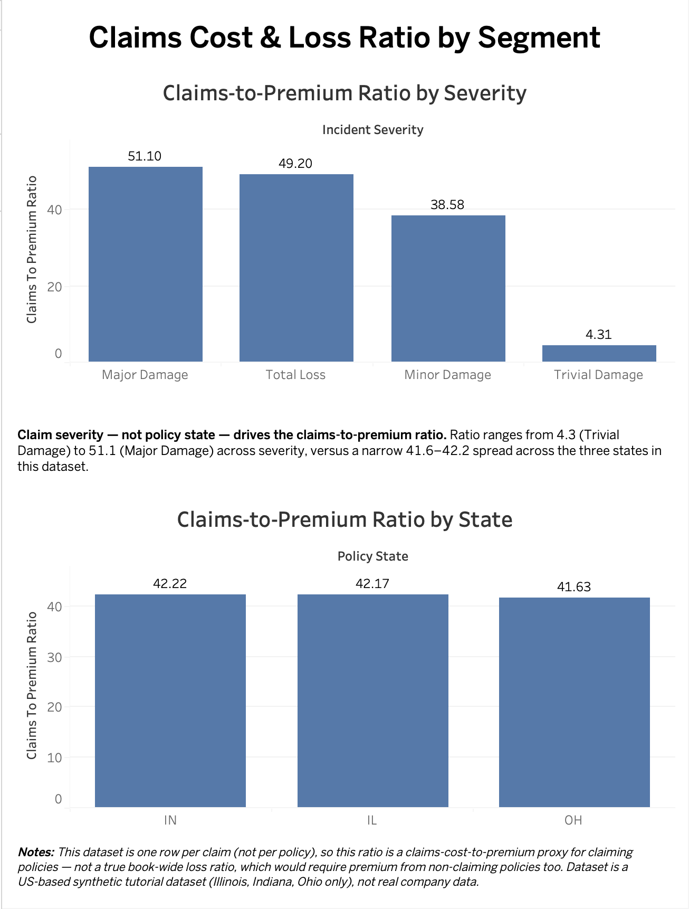

# Claims Cost & Loss Ratio by Segment

**Live dashboard:** https://public.tableau.com/app/profile/aayush.yagol/viz/claims_cost_loss_ratio_dashboard/Dashboard1

A simple, from-scratch SQL + Tableau dashboard that tests whether claim severity or policy state better explains claims-cost pressure in an auto insurance book.

---

## Why this project

Insurers price risk differently across segments (region, vehicle type, severity, etc.), and loss ratio — claims paid ÷ premium collected — is the standard metric for whether a segment is profitable. Underwriting teams need a fast, segment-level view of this to catch problems before they become bigger ones.

This project turns claims-pattern intuition (built from day-to-day work as a Claims Advisor) into an aggregated, numbers-backed dashboard — a portfolio-monitoring tool a team would check regularly, distinct from a per-quote predictive model.

## Key finding

**Claim severity — not policy state — drives the claims-to-premium ratio.**

| Cut | Range |
|---|---|
| By severity | 4.3 (Trivial Damage) → 51.1 (Major Damage) |
| By state | 41.6 → 42.2 (IL, IN, OH — a ~0.6-point spread) |

Geography barely differentiates this book; severity does almost all the work.

## Dataset

A 1,000-row synthetic auto insurance claims dataset (one row per claim, originally built for an IBM Watson fraud-detection tutorial).

- Source: [insurance_claims.csv](https://raw.githubusercontent.com/Jai-Ds/Insurance-Fraud-Claims-Detection/master/insurance_claims.csv)
- Scope: Illinois, Indiana, Ohio only (`policy_state`)
- Incident dates span a 60-day window (2015-01-01 to 2015-03-01) — too narrow to support a meaningful monthly trend, so a trend chart was deliberately **not** included

## Important limitation — read before trusting the numbers

This dataset is **one row per claim**, with no record of policies that never claimed. That means the "ratio" here is **not a true book-wide loss ratio** (which requires premium from non-claiming policies too) — it's a **claims-cost-to-premium proxy for policies that did claim**. This is stated directly on the dashboard, not glossed over.

## Design decisions

- **Primary segment: `policy_state`**, not `incident_state` — the underwriting book is organized by where the policy was written, not where the incident happened.
- **Secondary cut: `incident_severity`** — turned out to be the more meaningful lens once the state cut showed almost no spread.
- **Monthly trend query dropped from the dashboard** after confirming the real date range was only 60 days; kept in the SQL for transparency, not charted.

## Stack

- **MySQL** — data load, profiling, aggregation, and hand-verification queries
- **Tableau Public** — dashboard layer, built from two exported CSV summaries (`policy_state_summary.csv`, `severity_summary.csv`), since Tableau Public's free desktop app doesn't support a direct MySQL connection

## Verification

Before charting, results were hand-checked two ways:
1. **Spot check** — sampled raw rows within the smallest segment to confirm no implausible outliers were skewing the average.
2. **Row-count reconciliation** — summed per-segment claim counts back against the table's total row count (1,000 = 1,000) to catch any row loss or duplication from the `GROUP BY`.

## Repo contents

- `sql/` — segment aggregation query, monthly trend query (unused on dashboard), incident_severity cut, hand sanity-check queries
- `data/` — exported CSV summaries used as Tableau's data source
- `tableau_dashboard/` — dashboard screenshot (PNG) and Tableau workbook (`.twb`)
- Dashboard — published on Tableau Public (link above)
